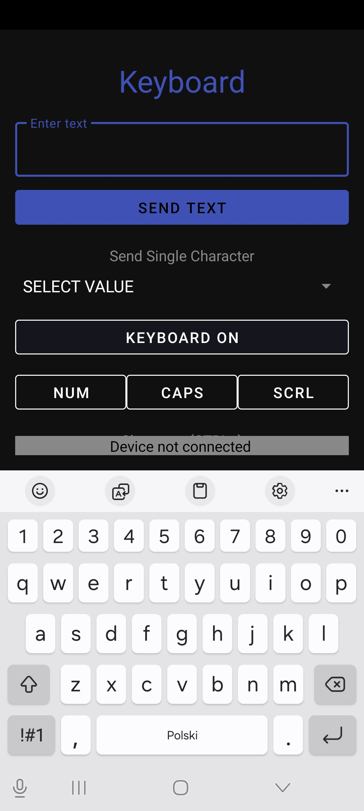
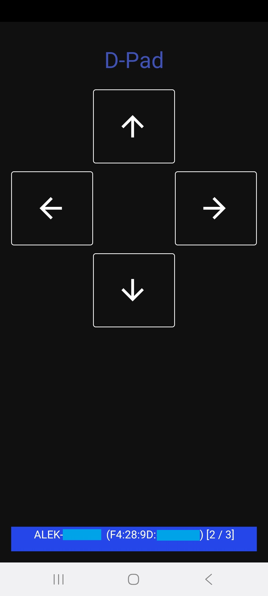

# BLE_HID_EXAMPLE
Example of HID over GATT (Bluetooth Low Energy) Android Application. The application emulates a peripheral BLE device (mouse, keyboard, or remote) that can be connected to a PC, tablet, or smartphone.

In version 2.0, the legacy "basic mode" has been removed to provide a unified, high-performance experience. The application consists of 5 full-screen fragments. When more than one device is connected, notifications are sent to all connected devices simultaneously.

## Configuration fragment

- **Reboot application button** - restarts the application and the Bluetooth stack. Useful for refreshing the connection state if any issues occur.
- **Clear configs button** - deletes saved device pairings and configurations if connection issues occur.
- **List of currently connected devices** - shows the names and addresses of all connected hosts.

## Consumer control fragment

- **Music/player control** - buttons for previous track, stop, play/pause, and next track.
- **Volume & Brightness** - quick adjustments for sound and screen brightness.
- **System control** - perform system actions like sleep, hibernation, shut down, or restart.
- **Application launch** - start selected applications such as a calculator or web browser. Supported by specific operating systems.
- **Application control** - perform actions like "help" or "search" in the currently focused app. Note: these actions are highly application-specific.

## Mouse fragment

- **Buttons (1, 2, 3, 4, 5)** - emulates standard mouse button clicks.
- **Touchpad area** - move the cursor; double-tap emulates a left-click.
- **Volume buttons** - the phone's physical volume up/down buttons emulate the mouse scroll wheel.

## Keyboard fragment
 

- **Send text** - type a phrase and send it to the computer all at once.
- **Send character** - a dropdown list to select and send a single special character or function key.
- **Keyboard shortcuts** - dedicated buttons for common actions like copy, paste, and select all.
- **LED indicators** - shows and toggles the status of Caps Lock, Num Lock, and Scroll Lock received from the host.
- **Keyboard On/Off** - enables or disables the software keyboard for direct character input.

## D-Pad fragment

- **Arrow buttons** - sends up/down/left/right arrow keys. Perfect for presentations or simple navigation.

---

## What's new in version 2.0
- **AI-Driven Modernization:** The entire project was refactored and updated in collaboration with **Gemini in Android Studio**.
- **Android 14 Support:** Fully updated for the latest security and permission requirements.
- **Enhanced Keyboard:** Added LED status lights and productivity shortcuts (Ctrl+C, Ctrl+V, etc.).
- **Smoother Mouse:** Implemented motion merging to prevent cursor "jumping".
- **Better Stability:** New notification queue system to handle multiple connections reliably.
- **Simpler Experience:** Removed outdated "basic mode" and refactored the HID descriptor to use smaller, separate reports for better host compatibility.
