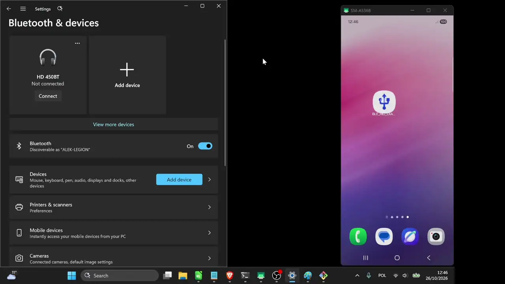
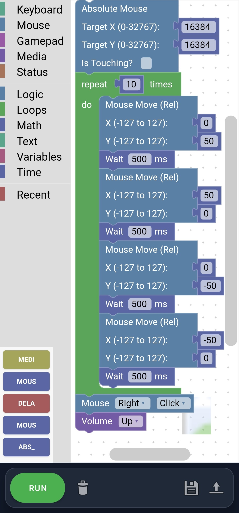
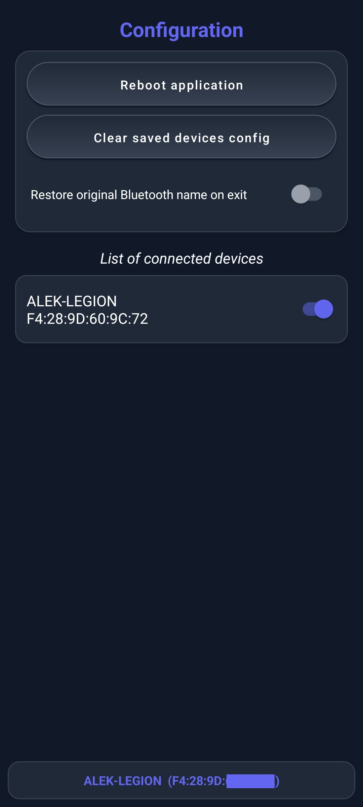
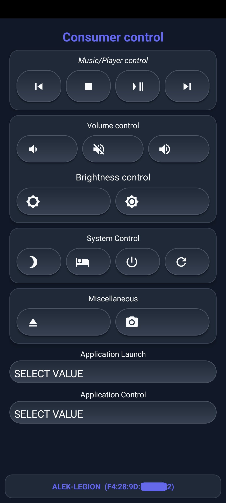
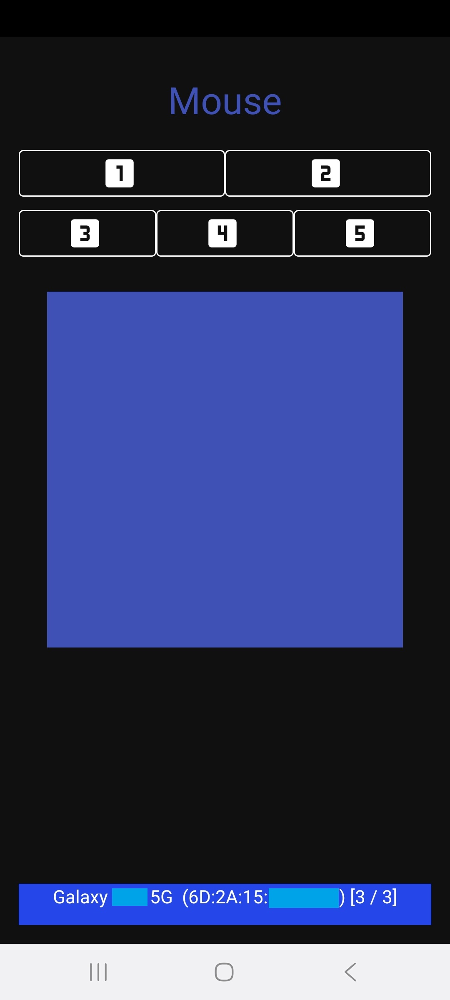
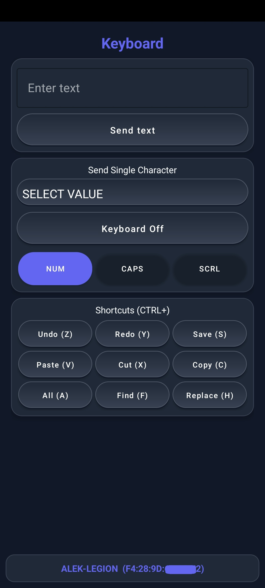
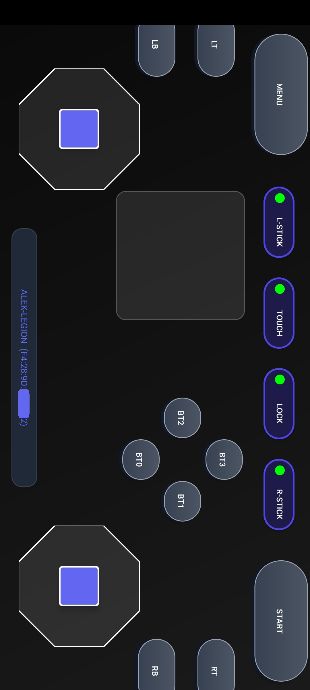
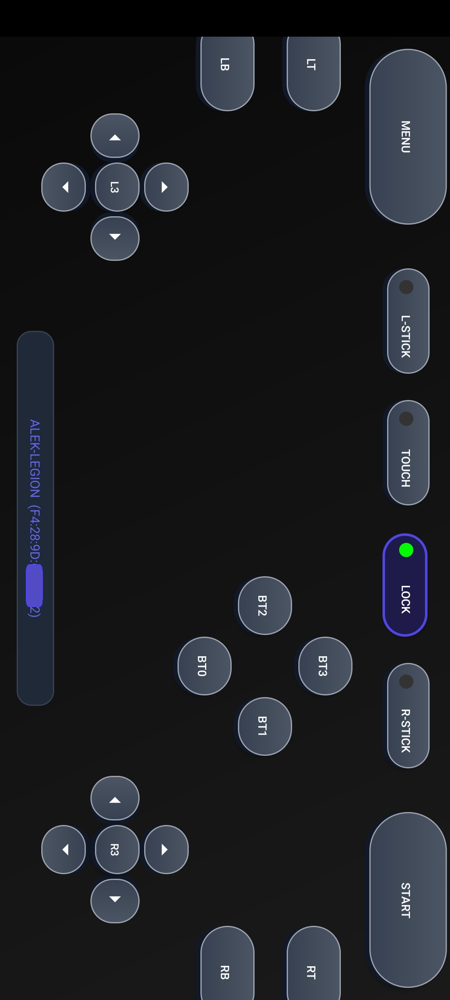
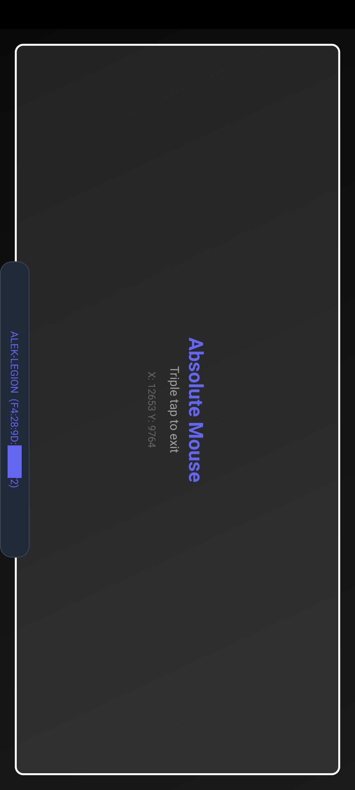

# BLE_HID_EXAMPLE

[-brightgreen.svg)](https://developer.android.com)
[](https://gradle.org)
[](https://developer.android.com/build)
[](LICENSE)

An advanced, modern Android application that emulates a versatile **Bluetooth Low Energy (BLE) Human Interface Device (HID) peripheral**. It turns an Android smartphone or tablet into a multi-functional virtual **Keyboard, Touchpad Mouse, Full Gamepad Controller, Absolute Digitizer, Consumer Media Remote, and Blockly Scripting Automation Engine**.

The application consists of 7 full-screen fragments. When more than one device is connected, notifications can be routed to all connected devices simultaneously or toggled individually per host.

---

<p align="center">
  
</p>

**Tools used in demo:**
- 💻 Windows System
- 🎨 MS Paint
- 📊 LibreOffice Calc
- 📝 Notepad
- 🌐 Brave Browser
  - 🎮 [HardwareTester Gamepad](https://hardwaretester.com/gamepad)
  - 🖱️ [Mouse Testers](https://mousetesters.com/)

---

## 📥 Download & Installation

[](https://github.com/04Alek04/BLE_HID_EXAMPLE/releases/latest)

1. **Download the APK:** Tap the button above or visit the [GitHub Releases Page](https://github.com/04Alek04/BLE_HID_EXAMPLE/releases/latest) to download `BLE_HID_EXAMPLE.apk`.
2. **Install on Android:** Open the downloaded `.apk` file on your device (allow *"Install from unknown sources"* if prompted).
3. **Pair & Control:** Open the app, grant Bluetooth permissions, and pair your phone with your PC or host device in Bluetooth Settings.

---

## Blockly fragment (Automation & Macros)


- **Visual Programming Workspace** - drag-and-drop Google Blockly interface to build custom HID macros and automated scripts over BLE.
- **Rich Block Library** - includes blocks for text typing, keyboard hotkeys, relative mouse movement, clicks, scrolling, absolute positioning, gamepad buttons/sticks, consumer media controls, delays, loops, variables, and conditional logic.
- **Run / Stop Execution** - execute programmed scripts in real-time or stop execution with a single tap (instantly flushes native BLE notification queues).
- **Save & Load** - save macros directly to internal storage (`macro_autosave.xml`) and reload them whenever needed.
- **UTF-8 Polish Character Support** - full Base64 UTF-8 encoding support for saving and loading scripts with special characters.

## Configuration fragment


- **Reboot application button** - cleanly restarts the application, the GATT server, and the Bluetooth advertising stack to recover stalled connections instantly.
- **Clear configs button** - deletes saved device pairings and configurations if connection issues occur.
- **List of connected devices with toggles** - displays connected hosts with individual switches to enable or disable HID notification routing per device.
- **Simultaneous Multi-Host Playback Example** - route Consumer Media commands (like Play/Pause or Stop) to multiple connected devices at once (e.g. starting or pausing a video simultaneously on a PC and a tablet connected at the same time).
- **Restore Bluetooth Name** - option to restore the original Bluetooth device name on exit.
- **Real-Time Device Status Bar** - persistent bottom status bar displaying live BLE connection state and active target host information.

## Consumer control fragment


- **Music/player control** - buttons for Previous Track, Stop, Play/Pause, and Next Track.
- **Volume & Brightness** - quick adjustments for sound volume (+/-), mute, and screen brightness (+/-).
- **System control** - perform system actions like Sleep, Hibernation, Shut Down, Cold Restart, Warm Restart, Eject, and Camera Snapshot.
- **Application launch dropdown** - select and launch operating system applications (Calculator, Web Browser, Email, Text Editor, Spreadsheet, Calendar, etc.).
- **Application control dropdown** - perform app-level commands like New, Open, Save, Close, Print, Undo, Copy, Cut, Paste, Select All, Find, Search, and Zoom.

## Mouse fragment


- **Buttons (1, 2, 3, 4, 5)** - emulates standard mouse button clicks (Left, Right, Middle, Button 4 / Back, Button 5 / Forward).
- **Touchpad area** - smooth relative cursor control with double-tap left click and delta-motion merging for zero cursor jitter.
- **Horizontal Scroll bar** - smooth horizontal panning/scrolling (h-scroll / tilt wheel).
- **Physical Volume buttons** - the phone's physical volume up/down buttons map to vertical mouse scroll wheel actions.

## Keyboard fragment


- **Send text & Clipboard Link Sharing** - type or paste a long URL link, password, or clipboard text snippet on your phone and send it all at once to the computer without typing letter-by-letter.
- **Send character** - a dropdown list to select and send single special characters or function keys (F1–F24, Esc, Tab, Backspace, Enter).
- **Polish & Accent Characters** - native AltGr (`META_RIGHT_ALT`) mapping for Polish letters (`ą`, `ć`, `ę`, `ł`, `ń`, `ó`, `ś`, `ź`, `ż`).
- **Keyboard shortcuts** - dedicated buttons for common actions: Undo (Ctrl+Z), Redo (Ctrl+Y), Save (Ctrl+S), Paste (Ctrl+V), Cut (Ctrl+X), Copy (Ctrl+C), Select All (Ctrl+A), Find (Ctrl+F), Replace (Ctrl+H).
- **LED indicators** - real-time status feedback for Caps Lock, Num Lock, and Scroll Lock received from the host.
- **Keyboard On/Off Toggle** - enables or disables the software keyboard for direct live typing with smart Caps Lock XOR logic.

## Gamepad fragment
<p align="left">
  
  &nbsp;&nbsp;
  
</p>

- **Dual Analog Sticks / D-Pad** - virtual L-Stick and R-Stick with octagonal bases, double-tap L3/R3 clicks, and independent toggles to switch between analog stick or digital D-Pad / ABXY button modes.
- **Action Buttons (BT0 - BT3)** - standard ABXY style action button diamond.
- **Shoulder Buttons & Triggers** - dedicated LB, RB, LT, and RT buttons.
- **Touchpad & System Keys** - integrated central touchpad area and MENU / START system buttons.
- **Control Toggles** - independent toggles for L-Stick, Touchpad, Tab Swiping Lock, and R-Stick.
- **Physical Volume Buttons** - physical volume up/down buttons map to shoulder/action buttons in Gamepad mode.

## Absolute Mouse fragment


- **Full-Screen Touch Surface & Digital Drawing** - absolute 0–32767 coordinate mapping for touchscreen/digitizer emulation, ideal for drawing, sketching in MS Paint/Photoshop, or signing documents on PC using your phone screen.
- **Triple-Tap Exit** - triple-tap anywhere inside the touch frame to exit back to standard mouse mode.
- **Physical Volume Buttons** - physical volume up/down buttons map to primary and secondary touch/click states.
- **Real-Time Coordinate Feedback** - displays live X/Y absolute coordinates.

---

## 🛠️ Windows Auto-Reconnect Script (`win_reconnect.ps1`)

The repository includes a PowerShell recovery script (`win_reconnect.ps1`) designed for Windows 10/11 hosts:

```powershell
# Run from CMD / Command Prompt:
powershell -ExecutionPolicy Bypass -File win_reconnect.ps1

# Or run directly inside PowerShell:
Set-ExecutionPolicy -Scope Process -ExecutionPolicy Bypass; .\win_reconnect.ps1
```

* **Fast Reconnect:** Queries paired BLE HID devices and forces uncached GATT service discovery.
* **Automatic Radio Recovery:** If Windows GATT stack hangs (`Unreachable`), the script automatically restarts `bthserv` and resets the Windows Bluetooth Radio Adapter PnP driver to restore active connection instantly.

---

## 🧪 Testing

The project features a full automated testing strategy with **29 passing tests**:

* **20 Unit Tests**
* **9 Espresso UI & Storage Tests**

---

## What's new in version 2.7
- **Manual BLE Advertising Trigger:** Added dedicated "Start BLE Advertising for Multi-Host" button in the Configuration fragment, allowing seamless onboarding of secondary hosts without dropping existing connections.
- **Custom Vector Launcher Icon**
- **Multi-Host Parallel Queue Architecture:** Upgraded `HidBleService` with per-device in-flight notification tracking (`mInFlightNotifications`), per-device MTU maps (`mDeviceMtu`), and non-blocking queue scheduling for zero cross-host latency.

---

## What's new in version 2.6
- **Full compatibility with Android 12+** and updated app navigation using ViewPager2.
- **Added a Variables tab in Blockly** for creating more advanced scripts.
- **Improved Windows integration** with a new PowerShell script for seamless reconnections (restarts Bluetooth adapter and cleans up old sessions).
- **Devices are now always properly recognized** with the "(HID)" prefix.
- **Optimized battery status updates** to use system receivers instead of draining resources with 60-second polling.
- **Resolved BLE connection stability** and Windows driver errors by fixing race conditions in GATT database and ADV reports.
- **Significantly improved text input stability** and fixed a rare bug that caused keys to get stuck.
- **Fixed Blockly execution in release builds** by handling code minification, added protection against infinite loops, and fixed UTF-8 handling.
- **Upgraded the tech stack** to Gradle 9.6.0, AGP 9.4.1, compileSdk 35, and updated AndroidX dependencies.
- **Added comprehensive automated UI and Unit tests.**
- **Refactored the architecture** by migrating to ViewBinding, introducing new helper classes (like AppPreferencesManager and TouchInputCalculator), and removing "magic values."

---

## What's new in version 2.5
- **Blockly Visual Automation Engine:** Integrated Google Blockly for creating, editing, saving, and executing automated HID macros and scripts (keyboard, mouse, gamepad, consumer controls, delays, loops, and conditional logic) over BLE.
- **Full Virtual Gamepad Mode:** Added a full-featured gamepad controller with dual analog sticks (L-Stick, R-Stick), D-Pad, L3/R3, ABXY buttons, LB/RB/LT/RT triggers, MENU/START, and an integrated touchpad.
- **Absolute Mouse / Digitizer:** Introduced a dedicated full-screen absolute positioning mode (0–32767 range) for touchscreen/digitizer emulation with a triple-tap exit gesture.
- **Horizontal Mouse Scroll:** Added horizontal scrolling/panning (h-scroll) support to the Mouse fragment.
- **Per-Device Management:** Ability to toggle HID notifications on or off for individual connected Bluetooth hosts directly from the configuration screen.
- **HID Battery Reporting:** Added Battery System HID report (Report ID 4) and live Battery Level service notifications.
- **Smart Keyboard Typing:** Smart Caps Lock synchronization with automatic Shift XOR logic and seamless background text input.
- **BLE Performance & Modern UI:** Implemented low-latency BLE connection requests (`HIGH_PRIORITY`) and redesigned the interface with a modern dark theme.

---

## What's new in version 2.0
- **AI-Driven Modernization:** The entire project was refactored and updated in collaboration with **Gemini in Android Studio**.
- **Android 14 Support:** Fully updated for the latest security and permission requirements.
- **Enhanced Keyboard:** Added LED status lights and productivity shortcuts (Ctrl+C, Ctrl+V, etc.).
- **Smoother Mouse:** Implemented motion merging to prevent cursor "jumping".
- **Better Stability:** New notification queue system to handle multiple connections reliably.
- **Simpler Experience:** Removed outdated "basic mode" and refactored the HID descriptor to use smaller, separate reports for better host compatibility.
